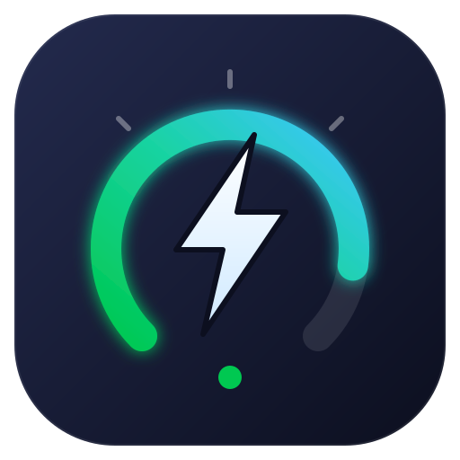
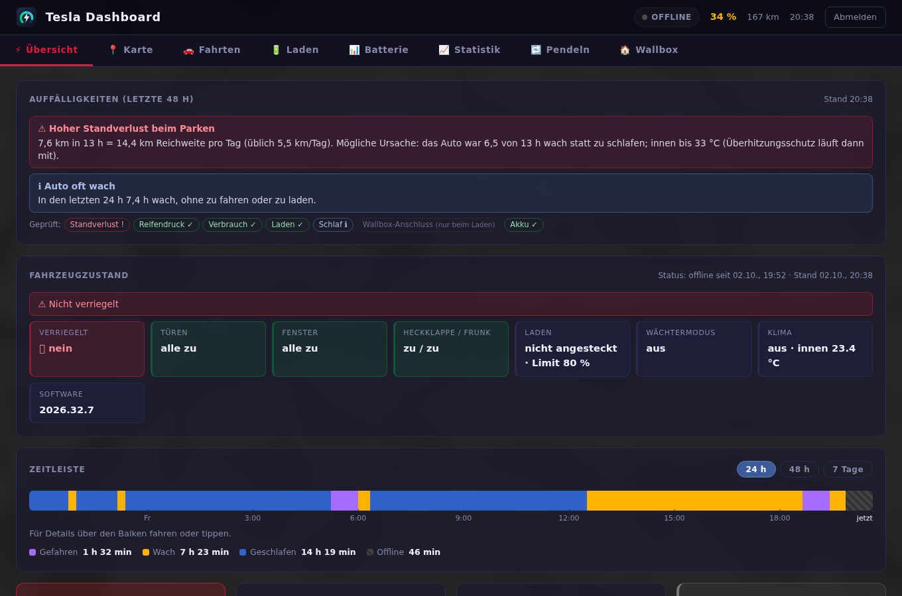

<p align="center"></p>

# Tesla-Dashboard

Ein schlankes, deutschsprachiges Web-Dashboard für **[TeslaMate](https://github.com/teslamate-org/teslamate)** – fürs Handy, den Browser im Auto und den PC.
Es liest nur (keine Befehle ans Auto) und braucht nichts außer PHP und der TeslaMate-Datenbank.

**Doku mit Screenshots:** https://www.ruthner.at/tesla-dashboard/



## Was es zeigt

| Tab | Inhalt |
|---|---|
| **Übersicht** | Akku, Reichweite, Position, **Auffälligkeiten der letzten 48 h** (hoher Standverlust mit Ursache, Reifendruck, Auto oft wach …), Fahrzeugzustand (Türen, Fenster, Wächtermodus), Zeitleiste |
| **Karte** | aktuelle Position, Fahrten des Tages oder der Woche mit Geschwindigkeit/Verbrauch |
| **Fahrten** | je Monat aufklappbar, Verbrauch, Kosten (Mischpreis daheim/anderswo) |
| **Laden** | Ladungen je Monat, daheim/anderswo getrennt, Wirkungsgrad, Kosten |
| **Batterie** | **Akkuverlauf der letzten 12 h–7 Tage** mit Fahrten und Ladungen, nutzbare Kapazität und Gesundheit, Degradation, Ladeeffizienz |
| **Statistik** | Verbrauch nach Temperatur und Geschwindigkeit, Klimaanteil, Monate |
| **Pendeln** | Fahrten zwischen festen Orten (z. B. Wohnort ↔ Arbeit) je Richtung |
| **Wallbox** | nur mit [DaheimLader](https://github.com/wolfiru/daheimlader): Leistung, Phasen, Hausanschluss und Lastbegrenzung, Leitungsverlust, Ladeziel |

## Voraussetzungen

- TeslaMate (Docker oder eigene PostgreSQL) – der Datenbank-Port muss vom Dashboard aus erreichbar sein
- Linux mit **PHP ≥ 8.1** (`php-pgsql`, `php-curl`, `php-mbstring`) und Apache oder nginx – der Installer bietet fehlende Pakete an
- optional: TeslaMates **MQTT-Broker** (Fahrzeugzustand, Ladeziel), **Cloudflare Access** für den Zugriff von außen, **DaheimLader** für den Wallbox-Tab

## Installation

```bash
git clone https://github.com/wolfiru/tesla-dashboard.git
cd tesla-dashboard
sudo ./install.sh
```

Der Installer fragt alles Nötige ab und prüft jede Verbindung sofort:

1. Pakete prüfen, Dateien nach `/var/www/tesla-dashboard` kopieren
2. **TeslaMate-Datenbank** finden (Docker-Container wird erkannt), eigene **Nur-Lese-Rolle** `tesla_dashboard` anlegen, Schema `auswertung` einspielen (verdichtet Fahrten einmalig – das Dashboard bleibt schnell)
3. **Orte**: daheim (für den Heimstrompreis) und Pendel-Orte – aus den TeslaMate-Geofences oder als Koordinaten
4. **Fahrzeugzustand** über MQTT (direkt beim Broker oder über ioBroker) – oder ohne
5. **DaheimLader** vorhanden? – sonst kein Wallbox-Tab
6. Akku (Kapazität neu, Werksreichweite – Vorschlag passend zum Modell), Reifendruck, **Strompreis** (Durchschnitt inkl. Netzgebühren, Abgaben, USt – oder aus den Teilen ausrechnen lassen)
7. **Zugang**: Heimnetz, HTTPS, optional Cloudflare Access; Login-Passwort setzen
8. Apache-Site anlegen

Die persönlichen Werte landen in `config.local.php` (nur root und Webserver lesbar, nicht im Git). Erneut `sudo ./install.sh` ändert sie, `git pull && sudo ./install.sh --update` aktualisiert nur das Programm.

## Sicherheit

- Login mit Passwort (Argon2id), Sperre nach Fehlversuchen je IP und gesamt, CSRF-Schutz, Sitzungen außerhalb des Web-Ordners (`/var/lib/tesla-dashboard`)
- Im Heimnetz bleibt man 7 Tage angemeldet, von außen 8 h
- **Cloudflare Access** (optional): Über den Tunnel prüft das Dashboard das Access-Token selbst (Signatur, Team, Anwendung, Ablauf, E-Mail). Auf Wunsch reicht dann die Cloudflare-Anmeldung ohne zusätzliches Passwort.
- Die Datenbank-Rolle darf nur lesen; TeslaMates Zugangs-Tokens (Schema `private`) sind für sie gesperrt

## Notfall

```bash
sudo php /var/www/tesla-dashboard/tools/zugang.php passwort     # neues Passwort
sudo php /var/www/tesla-dashboard/tools/zugang.php entsperren   # Login-Sperren aufheben
```

## Lizenz

MIT – siehe [LICENSE](LICENSE). Nicht mit Tesla, Inc. verbunden; „Tesla“ ist eine Marke der Tesla, Inc.
